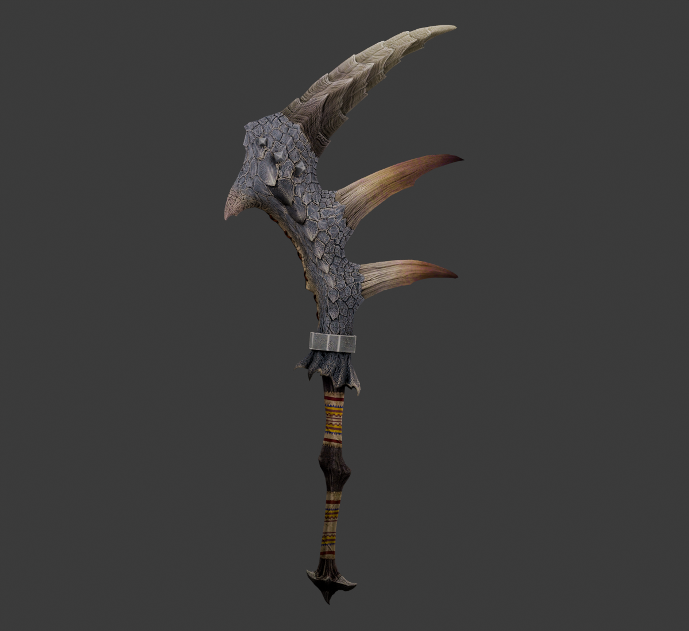

# 黑龙歼灭刀 · CQC-42

将《绝地潜兵 2》的 CQC-42 砍刀替换为《怪物猎人：世界》的黑龙歼灭刀，包含模型、太刀收刀／挥刀／拔刀音效，以及简体中文名称和描述。



## 安装

从 [Releases](https://github.com/Nero-UMU/Helldivers2_MacheteToLongsword/releases/latest) 下载 `Fatalis_CQC42_Mod.zip`，导入 Arsenal 或 Helldivers 2 Mod Manager 后启用。更新时先移除旧版。手动安装见 [安装说明](README_安装说明.md)。

## 素材与调整

- 收刀使用 04；挥刀使用 09、16，各对应三个随机采样位置；拔刀使用 12。
- 收刀音量在原版容器设置上提高 16 dB；拔刀裁去开头 0.75 秒的轻声铺垫。
- 移除这三个动作的原版插件刀声层，保留命中声和装备动作附加声。
- 简体中文名称为“黑龙歼灭刀”，描述为“只要被其砍伤后伤口就无法愈合，即使百年后仍将受伤痛的折磨。”

## 构建

使用 Windows，安装《绝地潜兵 2》及已配置游戏路径的 [HD2SDK Community Edition](https://github.com/Boxofbiscuits97/HD2SDK-CommunityEdition)。本项目使用 Blender 5.2、SDK 3.11、Wwise 2025.1.10、FFmpeg 8.1 和 vgmstream r2117。

将 `blender`、`ffmpeg`、`vgmstream-cli` 加入 PATH，设置 Wwise 安装目录环境变量 `WWISEROOT`。也可用 `FFMPEG`、`VGMSTREAM` 和 `WWISE_CONSOLE` 指定对应程序的完整路径。SDK 按 Blender 5.2 的默认插件目录加载。

在仓库根目录执行：

```powershell
python -m pip install -r requirements.txt
blender --background --factory-startup --python tools/extract_machete_audio.py
python tools/build_audio_bank.py
blender --background --factory-startup --python tools/build_mod.py
blender --background --factory-startup --python tools/verify_mod.py
python tools/package_mod.py
```

输出为根目录的 `Fatalis_CQC42_Mod.zip`。`Fatalis_CQC42.blend` 是可编辑工程；`source` 保存模型、纹理与四段音效输入；[selected_audio.json](audio_inspection/mhw_source/selected_audio.json) 保存替换映射。

仅调整音效时，运行 `build_audio_bank.py`，再用 Blender 运行 `add_audio.py`，随后运行 `verify_audio.py` 和 `package_mod.py`。

## 许可

代码采用 [MIT](LICENSE) 许可。游戏素材与第三方代码的来源、权利范围见 [素材与工具来源](THIRD_PARTY_NOTICES.md)。
